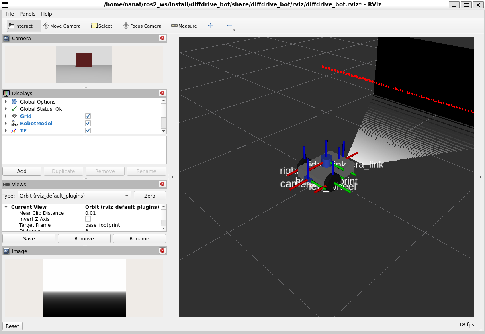
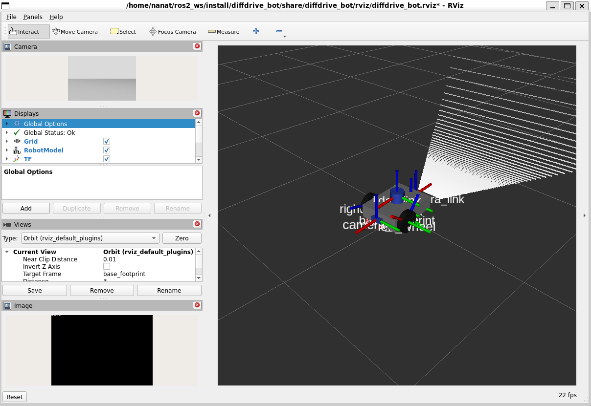

# Lab 1 – Introduction to Robotics and Intelligent Systems

## 1. Overview

This project implements a mobile robot simulation using ROS 2 Humble and Gazebo. It focuses on robot sensors, ROS 2 communication, custom interfaces, services, and actions.

The main objective is to control a differential-drive robot, detect obstacles, and make the robot move in a square trajectory.

## 2. Project Structure

The project contains the following packages:

- **diffdrive_bot** – Contains the robot description, Gazebo simulation, sensors, and ROS-Gazebo bridges.
- **lab_interfaces** – Contains custom interfaces for obstacle information and driving distance.
- **my_robot_interfaces** – Contains custom messages, services, and actions.
- **my_robot_nodes** – Contains Python nodes for robot control and movement.

## 3. Robot Sensors

The simulated robot is equipped with the following sensors:

- **LiDAR:** Detects nearby obstacles and provides distance information.
- **Depth Camera:** Publishes depth images and point cloud data.
- **IMU:** Measures acceleration and angular velocity.
- **Odometry:** Provides information about the robot's movement and position.

The sensor data is made available to ROS 2 through Gazebo-ROS bridges.

### Sensor Visualization

The following screenshot shows the robot's sensor visualization in RViz.



## 4. Custom Interfaces

The project uses custom ROS 2 interfaces to support communication between nodes.

### Messages

- `ObstacleInfo.msg` – Contains obstacle distance and angle information.
- `RobotStatus.msg` – Reports the robot's current state and obstacle distance.

### Services

- `SetTurnSpeed.srv` – Allows the robot's turning speed to be changed.
- `/turn_away_enable` – Enables or disables the obstacle-avoidance behavior.

### Actions

- `DriveDistance.action` – Controls how far the robot travels.
- `Rotate.action` – Controls the robot's rotation.

## 5. Implemented Nodes

### 5.1 turn_away

This node subscribes to obstacle information and publishes velocity commands and robot status.

It also provides services to enable or disable obstacle avoidance and change the turning speed.

### 5.2 rotate_server

This action server handles robot rotation using odometry feedback. It receives rotation goals and reports the robot's progress.

### 5.3 square_driver

This action client communicates with the drive-distance and rotation action servers.

It commands the robot to drive four sides, performing a 90-degree rotation after each side to complete a square trajectory.

## 6. Build Instructions

Source ROS 2 Humble and build the workspace:

```bash
source /opt/ros/humble/setup.bash
cd ~/ros2_ws
colcon build --symlink-install
source install/setup.bash
```

## 7. Running the Simulation

First, start the robot simulation:

```bash
source /opt/ros/humble/setup.bash
source ~/ros2_ws/install/setup.bash
ros2 launch diffdrive_bot control.launch.py
```

Open another terminal and start the square-driving demonstration:

```bash
source /opt/ros/humble/setup.bash
source ~/ros2_ws/install/setup.bash
ros2 launch my_robot_nodes square.launch.py
```

## 8. Testing and Results

The following tests were performed:

- Verified that the depth camera publishes depth image data.
- Verified that the IMU publishes sensor measurements.
- Verified that obstacle information is published.
- Tested the obstacle-avoidance enable service.
- Tested the turning-speed service with valid and invalid values.
- Tested the drive-distance action server.
- Verified the robot's rotation behavior.
- Tested the square-driving demonstration.

### Square Movement Result

The square-driving demonstration completed successfully in Gazebo.

Before starting, the square driver waited for the action servers and odometry data to become available. The robot then drove four sides and performed a 90-degree rotation after each side.

The terminal confirmed successful completion with the message:

`Square movement completed!`

## 9. Screenshots

### 9.1 Depth Camera and Point Cloud


### 9.2 Square Movement



## 10. Conclusion

This lab provided practical experience with ROS 2 communication, custom messages, services, actions, robot sensors, and Gazebo simulation.

The completed square-driving demonstration showed how multiple ROS 2 nodes and action servers can work together to control a simulated mobile robot.
